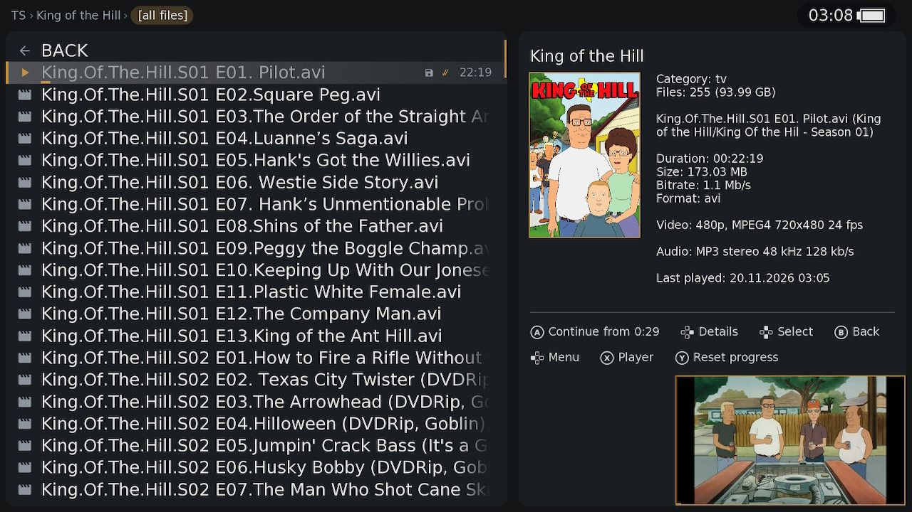

pPlay
======

**English** | [Русский](README_RU.MD)

> This repository is a fork of the long-unmaintained original [pPlay](https://github.com/Cpasjuste/pplay) by **cpasjuste**,
> built on his [libcross2d](https://github.com/Cpasjuste/libcross2d) library.

| Filer view | Player view |
|:-----------------------------------------------------------------:|:------------------------------------------------------------------:|
|  |  |

pPlay is a cross-pltform video player, built around **MPV/FFmpeg**, that supports most popular video format,
subtitles, network streaming and more.

Supported features:
- Local and network media playback;
- Subtitles, audio, and video tracks selection;
- Playback modes and standard navigation;
- SSL verification support.

Supported protocols & networks:
- HTTP(S), FTP, WebDAV, and SMB/Samba (`smb://`);
- DLNA / UPnP media servers;
- TorrServer client integration (MatriX, Silo);
- P2Play MediaMesh (early test).

pPlay uses the [MPV](https://mpv.io/) interface to handle FFmpeg interoperability, providing a fast, stable and powerful playback experience.

Installation
----
- **PS4:** just install the `.pkg` file from latest `pPlay-<version>-PS4.zip`.
- **PS5:** choose one of the following methods:
  - **PKG:** install the `.pkg` from latest `pPlay-<version>-PS5.zip` (a PS4 fpkg, needs `elfldr` on port 9021).
    It copies pPlay and libraries to `/data/homebrew/pplay`, then starts application.
  - **Manual:** extract `pPlay-<version>-PS5_websrv.zip` to `/data/homebrew/pplay` and start `pplay.elf` from the Homebrew Launcher (websrv).
- **Switch:** put the `.nro` file from latest `pPlay-<version>-Switch.zip` to your launcher root.
- **Linux (x86_64):** run the latest `pPlay-<version>-Linux-x86_64.AppImage` (glibc 2.35+: Ubuntu 22.04, Debian 12, Fedora 36 and newer).
  Settings, `mpv.conf` and caches are in `~/.config/pplay/`.

Usage and controls
-----
| Action | PS4 / PS5 | Switch | Keyboard/Remote (PS4/PS5) | Linux |
| :--- | :--- | :--- | :--- | :--- |
| Move / Switch windows | Analog Sticks / D-Pad | Analog Sticks / D-Pad | Arrows (or Numpad) | Arrows |
| Confirm (OK) / Pause | `CROSS` | `A` | `Enter` / `Space` | `Enter` / `Space` |
| Back / Minimize player | `CIRCLE` | `B` | `Esc` / `Backspace` | `Esc` / `Backspace` |
| Menu / Track selection | `SQUARE` | `X` | `X` / `Menu` | `Tab` / `Menu` |
| Secondary action | `TRIANGLE` | `Y` | `Y` / `Delete` | `Delete` |
| Rewind / Speed (`LT`/`RT`) | `L2` / `R2` | `ZL` / `ZR` | `[` / `]` | `Home` / `End` |
| Previous / Next (`LB`/`RB`) | `L1` / `R1` | `L` / `R` | `PageUp` / `PageDown` | `PageUp` / `PageDown` |
| Playback info / Hints | `Options` | `+` | `F1` | `F1` |
| Toggle fullscreen | — | — | — | `F11` |
| Volume control (in player) | `UP` / `DOWN` | `UP` / `DOWN` | `UP` / `DOWN` | `UP` / `DOWN` |
| Brightness control (in player) | `TRIANGLE` + `UP`/`DOWN` | `X` + `UP`/`DOWN` | `Delete` + `UP`/`DOWN` | `Delete` + `UP`/`DOWN` |

In the file browser `RIGHT` moves to the information panel: the D-Pad scrolls it, at its end the key hints
become buttons (TV remotes have no `SQUARE` / `TRIANGLE`); `LEFT` or Back returns to the files.
The menu key (`SQUARE`) returns to the minimized video.

Fork additions
----

Below are the main practical improvements and modernizations included in this fork:

1. **Networks**: any number of network sources, each with its own type, name, credentials, timeout,
   certificate check and remembered last directory; added, moved and deleted in Settings > Networks.
2. **TorrServer integration**: torrent browsing, files playback and watched-state support.
3. **Samba/SMB support**: custom `smb://` mpv handler, configurable SMB read buffer.
4. **Flexible network retry/timeouts**: playback retry count, connection timeout per network.
5. **UX/player options**: settings menu with configurable seek intervals, autoplay-after-finish behavior,
   swapped controls mode, UI accent color, logging and more.
6. **Interface languages**: Settings > Language (see below).
7. **Configuration editor**: Settings > Edit files: `pplay_config.json`, `mpv/mpv.conf`, `mpv/input.conf`,
   the whole file in the system keyboard (multiline, up to 2048 characters) or line by line. `pplay_config.json` is applied right away (an invalid file is rejected), mpv files on the next start.
8. **Playback**: preferred audio/subtitles languages, external audio and subtitles files, volume control
   and normalization (incl. night mode), network buffer settings, video quality presets, fast seeking in `.mkv` files without index, visualization for audiofiles.
9. **Distribution**: single file installation on all platfoms.

Interface languages
----

Languages are plain text files, `lang/<code>.lang` (utf-8), in the bundled data and in the pPlay data directory
(a file there adds a language or overrides the bundled one).
Settings > Language lists the files found and applies the choice right away:

```ini
@name = Русский          # name shown in Settings > Language
Settings = Настройки     # english text = translation
```

`lang/en.lang` lists every key: copy it to start a new language.

Networks
----

Settings > Networks > Add network creates a network, Settings > Networks > Network x sets it up:

* **Type** (`type`):
  * `TorrServer.MatriX` — TorrServer api (`http(s)://host:8090/`, may be behind a reverse proxy sub path);
  * `TorrServer.Silo` — the new TorrServer (its `silo` branch), the same address; it works with a **Token** (`token`):
    got with the user and password once (an empty user = `owner`) and written next to them, or typed. The user
    and password may be cleared then; kept, they get a new token when it is refused. Its links
    (`.../api/stream/<hash>/<n>?token=...`) open in the network of that token;
  * `WebDAV` — `http(s)://host/path/` (Nextcloud, nginx dav, rclone serve webdav...);
  * `DLNA` — a media server, its device description url (`http://host:8200/rootDesc.xml`), or just `http://host:port/`;
  * `Samba` (`smb://host/share/`), `FTP` (`ftp://`), `HTTP` (`http(s)://` directory listing).
* **Name**, **URL**, **User**, **Password** (not for `DLNA`). The user and the password are kept apart from the url
  and added to it for the connections; a url typed with `user:password@` gets them moved to these fields.
* **Connection timeout**, **Certificate check** (`https://` only), **Synchronization** (`TorrServer.MatriX`, `TorrServer.Silo` only:
  the watched marks refresh period), **SMB buffer** (`Samba` only).
* **Search servers** (`DLNA`, `TorrServer.MatriX`, `TorrServer.Silo`, `Samba`): the servers of the local network (TorrServer and Samba:
  the addresses of its /24 tried, ports 8090 and 445); `smb://host/` lists its shares.
* **Move up**, **Move down**, **Delete network**.

TorrServer:

* pPlay retrieves torrent lists using the TorrServer API;
* displays torrent file structures as directories;
* streams selected files directly;
* uses/resets watched marks on the TorrServer side;
* the playback positions synced when the server keeps them;
* TorrServer.Silo: early test support.

Samba (SMB):

* Start with an SMB buffer of 10 MB (default), increase it (`1..100`) on unstable networks.
* Increase the connection timeout and Settings > Playback > Playback retry if playback interruptions occur.

P2Play MediaMesh:

* Discover and My lists expose MediaMesh catalogs; opening a discovered catalog requests subscription (the server requires an admin-rank account for subscriptions);
* Search by tag browses indexed records; opening a record adds it to the user's P2Play library and plays it through the native `/api/stream` endpoint.

## Known issues

* Nothing found yet, but the future is full of surprises.

## Configuration file

The settings are in `pplay_config.json`, in the pPlay data directory (`/data/pplay/` on PS4/PS5,
`~/.config/pplay/` on Linux). Groups follow Settings menu sections, `state` keeps what pPlay remembers by itself
(last paths, volume, session). Everything is set from the menu, the file is only needed for a manual edit
(Settings > Edit files, or by hand while pPlay is not running).

On the first start of this version the settings and networks are imported from `pplay.cfg`,
the old file itself is left as it is (for the older versions).

### Groups

* `playback` — `autoplay_mode` (`0` stop, `1` next file, `2` loop file, `3` loop directory), `network_retries`,
  `restore_session`, `restore_location` (`1` list at the restored file, `0` at the last location),
  `seek_preview` (preview position while seeking: `2` always, `1` local files only, saved too, `0` off), `sleep_timer` (minutes, `-1` end of file).
* `progress` — `progress_min_length`, `watched_tolerance`, `progress_interval`, `progress_line`, `folder_marks`,
  `ts_progress_sync` (`0` off, `1` local first, `2` TorrServer first).
* `audio_and_subtitles` — `audio_language` (`Auto`), `sub_language` (`Off`): mpv `alang` / `slang` lists like `rus,ru`,
  `Auto` / `Off` keep `mpv.conf` ones; `external_tracks`, `sub_ass_plain`, `audio_channels`,
  `audio_normalize` (`0` off, `1` normalize, `2` night mode), `audio_visualizer`.
* `video` — `video_quality` (`3` auto, `0` best, `1` balanced (default), `2` fast, see below),
  `auto_drops`, `auto_drops_time`, `auto_quality_delay`, `auto_switch_pause`, `hw_decoding` (`2` auto, `1` on, `0` off),
  `auto_hw_retry`, `auto_hw_retries`, `dither`.
* `interface` — `language` (`lang/<code>.lang`), `text_encoding`, `accent_color` (`#1078C8`), `show_hidden`, `show_all_files`,
  `show_saved`, `show_playlists`, `media_probe` (media information read on selection, cached in `cache/`),
  `osd_hide_time` (seconds, `0` never), `swap_controls`; `ps5_ui_4k` on PS5.
* `networks` — `cache_secs` (`10..600`), `cache_mb` (`50..1000`, `50..500` on Switch) and `list`, the networks in the menu order:

  | Key | Meaning |
  | :--- | :--- |
  | `name` | label shown in UI (empty: "Network x") |
  | `type` | `TorrServer.MatriX`, `TorrServer.Silo`, `Samba`, `FTP`, `HTTP`, `WebDAV`, `DLNA` |
  | `url` | address, without user and password |
  | `user`, `password` | credentials (`DOMAIN\user` for Samba) |
  | `token` | `TorrServer.Silo` api token |
  | `timeout` | connection timeout, seconds (default `15`) |
  | `tls_verify` | `1` check the https certificate (default), `0` not |
  | `sync` | TorrServer marks refresh period, seconds (default `30`) |
  | `smb_buffer` | Samba read buffer, MB, `1..100` (default `10`) |
  | `last` | last opened directory |
* `saved_files` — `save_threads`, `save_keep_days`, `save_max_gb` (`0`: no limit).
* `system` — `home_path`, `standby_time`, `log_level` (`0..4`: off, error, info, debug, trace; on PS4 fatal crashes
  are also written to `/data/pplay/crash.log`); `android_background`, `cpu_boost` (Switch), `ps5_keep_in_rest` on their platforms.

### Example

```json
{
  "interface": {
    "language": "en",
    "accent_color": "#1078C8"
  },
  "networks": {
    "cache_secs": 60,
    "cache_mb": 150,
    "list": [
      {
        "name": "TorrServer",
        "type": "TorrServer.MatriX",
        "url": "http://192.168.1.10:8090/",
        "user": "",
        "password": "",
        "timeout": 15,
        "tls_verify": 1,
        "sync": 30,
        "smb_buffer": 10,
        "last": "/"
      },
      {
        "name": "NAS",
        "type": "Samba",
        "url": "smb://192.168.1.50/media/",
        "user": "DOMAIN\\user",
        "password": "password",
        "timeout": 20,
        "tls_verify": 1,
        "sync": 30,
        "smb_buffer": 16,
        "last": "/"
      }
    ]
  }
}
```

Missing keys get their defaults.

## MPV configuration

As pPlay use [MPV](https://mpv.io/), you can place an `mpv.conf` file inside the `/data/pplay/mpv` directory and use native MPV options directly.

See:

* [MPV configuration files](https://mpv.io/manual/master/#configuration-files)
* [MPV options](https://mpv.io/manual/master/#options)

### Video quality presets

Settings > Video > Video quality (`video_quality`) overrides a few mpv options only, the rest of `mpv.conf`
always applies:

| Option | Best | Balanced (default) | Fast |
| :--- | :--- | :--- | :--- |
| `scale`, `dscale`, `cscale` | `mpv.conf` | `bilinear` | `bilinear` |
| `correct-downscaling`, `linear-downscaling`, `sigmoid-upscaling`, `deband`, `hdr-compute-peak` | `mpv.conf` | `no` | `no` |
| `vd-lavc-skiploopfilter` | `mpv.conf` | `nonref` | `all` |
| `vd-lavc-fast`, `framedrop` | `mpv.conf` | `mpv.conf` | `yes`, `decoder+vo` |

"Best" restores the values read at start (`mpv.conf`, or pPlay defaults when not set there), so `mpv.conf` changes
apply to it after a restart. Conditional profiles (`profile-cond`) setting these options override the preset for
the files they match.
