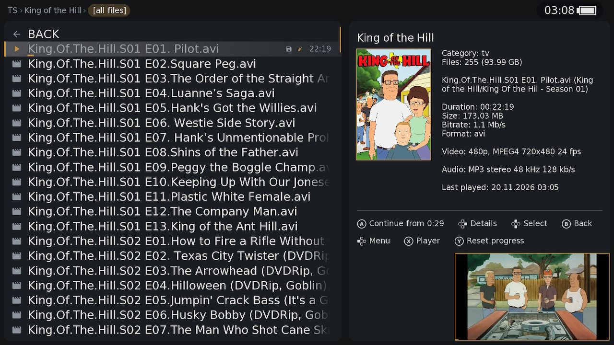

pPlay
======

[English](README.MD) | **Русский**

> Этот репозиторий — форк давно не поддерживаемого оригинального проекта [pPlay](https://github.com/Cpasjuste/pplay) от **cpasjuste**,
> основанного на его библиотеке [libcross2d](https://github.com/Cpasjuste/libcross2d).

| Список файлов | Плеер |
|:-----------------------------------------------------------------:|:------------------------------------------------------------------:|
|  |  |

pPlay — кроссплатформенный видеоплеер на основе **MPV/FFmpeg** с поддержкой большинства популярных форматов видео,
субтитров, сетевого воспроизведения и не только.

Возможности:
- Воспроизведение локальных и сетевых файлов;
- Выбор дорожек видео, звука и субтитров;
- Режимы воспроизведения и привычная навигация;
- Проверка SSL-сертификатов.

Протоколы и сети:
- HTTP(S), FTP, WebDAV и SMB/Samba (`smb://`);
- Клиент TorrServer.

pPlay работает с FFmpeg через интерфейс [MPV](https://mpv.io/): быстро, стабильно и с широкими возможностями.

Установка
----
- **PS4:** установите `.pkg` из последнего `pPlay-<version>-PS4.zip`.
- **PS5:** один из способов:
  - **PKG:** установите `.pkg` из последнего `pPlay-<version>-PS5.zip` (PS4 fpkg, требуется `elfldr` на порту 9021).
    Он копирует/обновляет pPlay и библиотеки в `/data/homebrew/pplay`, если их нет, и запускает приложение.
  - **Вручную:** распакуйте `pPlay-<version>-PS5_websrv.zip` в `/data/homebrew/pplay` и запустите `pplay.elf` из Homebrew Launcher (websrv).
- **Switch:** положите `.nro` из последнего `pPlay-<version>-Switch.zip` в корень лаунчера.
- **Linux (x86_64):** запустите последний `pPlay-<version>-Linux-x86_64.AppImage` (нужна glibc 2.35+: Ubuntu 22.04, Debian 12, Fedora 36 и новее).
  Настройки, `mpv.conf` и кэш лежат в `~/.config/pplay/`.

Управление
-----
| Действие | PS4 / PS5 | Switch | Клавиатура/Пульт (PS4/PS5) | Linux |
| :--- | :--- | :--- | :--- | :--- |
| Перемещение / переключение окон | Стики / крестовина | Стики / крестовина | Стрелки (или Numpad) | Стрелки |
| Подтвердить (OK) / пауза | `CROSS` | `A` | `Enter` / `Space` | `Enter` / `Space` |
| Назад / свернуть плеер | `CIRCLE` | `B` | `Esc` / `Backspace` | `Esc` / `Backspace` |
| Меню / выбор дорожек | `SQUARE` | `X` | `X` / `Menu` | `Tab` / `Menu` |
| Дополнительное действие | `TRIANGLE` | `Y` | `Y` / `Delete` | `Delete` |
| Перемотка / скорость (`LT`/`RT`) | `L2` / `R2` | `ZL` / `ZR` | `[` / `]` | `Home` / `End` |
| Предыдущий / следующий (`LB`/`RB`) | `L1` / `R1` | `L` / `R` | `PageUp` / `PageDown` | `PageUp` / `PageDown` |
| Playback info / Hints | `Options` | `+` | `F1` | `F1` |
| Полноэкранный режим | — | — | — | `F11` |
| Громкость (в плеере) | `UP` / `DOWN` | `UP` / `DOWN` | `UP` / `DOWN` | `UP` / `DOWN` |
| Яркость (в плеере) | `TRIANGLE` + `UP`/`DOWN` | `X` + `UP`/`DOWN` | `Delete` + `UP`/`DOWN` | `Delete` + `UP`/`DOWN` |

В списке файлов `RIGHT` переводит на панель информации: крестовина прокручивает её, в конце подсказки
клавиш становятся кнопками (на ТВ-пультах нет `SQUARE` / `TRIANGLE`); `LEFT` или «Назад» возвращают к файлам.
Клавиша меню (`SQUARE`) возвращает к свёрнутому видео.

Что добавлено в форке
----

Основные практические улучшения этого форка:

1. **Сети**: любое число сетевых источников, у каждого свои тип, название, логин и пароль, таймаут,
   проверка сертификата и запоминание последней папки; добавляются, перемещаются и удаляются в Настройки > Сети.
2. **Интеграция с TorrServer**: просмотр торрентов, воспроизведение файлов и отметки о просмотре.
3. **Samba/SMB**: собственный обработчик `smb://` для mpv, настраиваемый буфер чтения SMB.
4. **Гибкие повторы и таймауты сети**: число попыток воспроизведения, таймаут соединения для каждой сети.
5. **Настройки интерфейса и плеера**: шаги перемотки, поведение по окончании воспроизведения,
   обмен кнопок, акцентный цвет, логирование и другое.
6. **Языки интерфейса**: Настройки > Язык (см. ниже).
7. **Редактор конфигурации**: Настройки > Редактор файлов: `pplay_config.json`, `mpv/mpv.conf`, `mpv/input.conf`,
   целиком в системной клавиатуре (многострочно, до 2048 символов) или построчно. `pplay_config.json` применяется сразу (некорректный файл отклоняется), файлы mpv — при следующем запуске.
8. **Воспроизведение**: предпочитаемые языки звука и субтитров, внешние файлы звука и субтитров,
   управление громкостью и нормализация
   (в т.ч. ночной режим), настройки сетевого буфера, пресеты качества видео, быстрая перемотка в `.mkv` без индекса, визуализация для аудиофайлов.
9. **Установка**: однофайловая установка на всех платформах.

Языки интерфейса
----

Языки — обычные текстовые файлы `lang/<код>.lang` (utf-8) во встроенных данных и в папке данных pPlay
(файл там добавляет язык или заменяет встроенный).
Настройки > Язык показывает найденные файлы и применяет выбор сразу:

```ini
@name = Русский          # название в Настройки > Язык
Settings = Настройки     # английский текст = перевод
```

В `lang/en.lang` перечислены все ключи: скопируйте его, чтобы начать новый язык.

Сети
----

Настройки > Сети > Добавить сеть создаёт сеть, Настройки > Сети > Сеть x — её настройки:

* **Тип** (`type`):
  * `TorrServer.MatriX` — API TorrServer (`http(s)://host:8090/`, может быть за обратным прокси с подпутём);
  * `TorrServer.Silo` — новый TorrServer (ветка `silo`), адрес тот же; работает по **токену** (`token`): он получается
    по логину и паролю (пустой логин = `owner`) и записывается рядом с ними, либо вводится вручную. Логин и пароль
    после этого можно очистить; если оставить, по ним берётся новый токен, когда старый не принят. Его ссылки
    (`.../api/stream/<hash>/<n>?token=...`) открываются в сети с этим токеном;
  * `WebDAV` — `http(s)://host/path/` (Nextcloud, nginx dav, rclone serve webdav...);
  * `DLNA` — медиасервер, адрес описания устройства (`http://host:8200/rootDesc.xml`) или просто `http://host:port/`;
  * `Samba` (`smb://host/share/`), `FTP` (`ftp://`), `HTTP` (список файлов `http(s)://`).
* **Имя**, **URL**, **Пользователь**, **Пароль** (кроме `DLNA`). Логин и пароль хранятся отдельно от адреса
  и подставляются в него при подключении; если ввести адрес с `user:password@`, они переносятся в эти поля.
* **Таймаут соединения**, **Проверка сертификатов** (только `https://`), **Синхронизация** (только `TorrServer.MatriX`, `TorrServer.Silo`:
  период обновления отметок о просмотре), **Буфер SMB** (только `Samba`).
* **Поиск серверов** (`DLNA`, `TorrServer.MatriX`, `TorrServer.Silo`, `Samba`): серверы локальной сети (TorrServer и Samba: перебор адресов
  её /24, порты 8090 и 445); `smb://host/` показывает список общих папок.
* **Переместить вверх**, **Переместить вниз**, **Удалить сеть**.

TorrServer:

* pPlay получает список торрентов через API TorrServer;
* показывает структуру файлов торрента как папки;
* воспроизводит выбранные файлы напрямую;
* использует и сбрасывает отметки о просмотре на стороне TorrServer;
* TorrServer.Silo: тестовая поддержка.

Samba (SMB):

* Начните с буфера SMB 10 МБ (по умолчанию), при нестабильной сети увеличьте его (`1..100`).
* Если воспроизведение прерывается, увеличьте таймаут соединения и Настройки > Воспроизведение > Попытки воспроизведения.

## Известные проблемы

* Пока ничего не найдено, но будущее полно сюрпризов.

## Файл конфигурации

Настройки хранятся в `pplay_config.json` в папке данных pPlay (`/data/pplay/` на PS4/PS5,
`~/.config/pplay/` на Linux). Группы повторяют разделы меню настроек, в `state` pPlay сам запоминает
последние пути, громкость и сеанс. Всё задаётся из меню, файл нужен только для ручной правки
(Настройки > Редактор файлов или вручную, пока pPlay не запущен).

При первом запуске этой версии настройки и сети импортируются из `pplay.cfg`,
а сам старый файл остаётся как есть (для старых версий).

### Группы

* `playback` — `autoplay_mode` (`0` стоп, `1` следующий файл, `2` повтор файла, `3` повтор папки), `network_retries`,
  `restore_session`, `restore_location` (`1` список у восстановленного файла, `0` в последнем месте),
  `seek_preview` (предпросмотр при перемотке: `2` всегда, `1` только локальные, включая сохранённые, `0` выкл.), `sleep_timer` (минуты, `-1` до конца файла).
* `progress` — `progress_min_length`, `watched_tolerance`, `progress_interval`, `progress_line`, `folder_marks`,
  `ts_progress_sync` (`0` выкл., `1` сначала локальный, `2` сначала TorrServer).
* `audio_and_subtitles` — `audio_language` (`Auto`), `sub_language` (`Off`): списки mpv `alang` / `slang` вида `rus,ru`,
  `Auto` / `Off` оставляют значения из `mpv.conf`; `external_tracks`, `sub_ass_plain`, `audio_channels`,
  `audio_normalize` (`0` выкл., `1` нормализация, `2` ночной режим), `audio_visualizer`.
* `video` — `video_quality` (`3` авто, `0` наилучшее, `1` сбалансированное (по умолчанию), `2` быстрое, см. ниже),
  `auto_drops`, `auto_drops_time`, `auto_quality_delay`, `auto_switch_pause`, `hw_decoding` (`2` авто, `1` вкл., `0` выкл.),
  `auto_hw_retry`, `auto_hw_retries`, `dither`.
* `interface` — `language` (`lang/<код>.lang`), `text_encoding`, `accent_color` (`#1078C8`), `show_hidden`, `show_all_files`,
  `show_saved`, `show_playlists`, `media_probe` (сведения о медиа при выборе файла, кэш в `cache/`),
  `osd_hide_time` (секунды, `0` никогда), `swap_controls`; `ps5_ui_4k` на PS5.
* `networks` — `cache_secs` (`10..600`), `cache_mb` (`50..1000`, `50..500` на Switch) и `list`, сети в порядке меню:

  | Ключ | Значение |
  | :--- | :--- |
  | `name` | название в интерфейсе (пусто: «Сеть x») |
  | `type` | `TorrServer.MatriX`, `TorrServer.Silo`, `Samba`, `FTP`, `HTTP`, `WebDAV`, `DLNA` |
  | `url` | адрес без логина и пароля |
  | `user`, `password` | логин и пароль (`DOMAIN\user` для Samba) |
  | `token` | API-токен `TorrServer.Silo` |
  | `timeout` | таймаут соединения, секунды (по умолчанию `15`) |
  | `tls_verify` | `1` проверять сертификат https (по умолчанию), `0` нет |
  | `sync` | период обновления отметок TorrServer, секунды (по умолчанию `30`) |
  | `smb_buffer` | буфер чтения Samba, МБ, `1..100` (по умолчанию `10`) |
  | `last` | последняя открытая папка |
* `saved_files` — `save_threads`, `save_keep_days`, `save_max_gb` (`0`: без ограничения).
* `system` — `home_path`, `standby_time`, `log_level` (`0..4`: выкл., ошибки, инфо, отладка, трассировка; на PS4 падения
  также пишутся в `/data/pplay/crash.log`); `android_background`, `cpu_boost` (Switch), `ps5_keep_in_rest` на своих платформах.

### Пример

```json
{
  "interface": {
    "language": "en",
    "accent_color": "#1078C8"
  },
  "networks": {
    "cache_secs": 60,
    "cache_mb": 150,
    "list": [
      {
        "name": "TorrServer",
        "type": "TorrServer.MatriX",
        "url": "http://192.168.1.10:8090/",
        "user": "",
        "password": "",
        "timeout": 15,
        "tls_verify": 1,
        "sync": 30,
        "smb_buffer": 10,
        "last": "/"
      },
      {
        "name": "NAS",
        "type": "Samba",
        "url": "smb://192.168.1.50/media/",
        "user": "DOMAIN\\user",
        "password": "password",
        "timeout": 20,
        "tls_verify": 1,
        "sync": 30,
        "smb_buffer": 16,
        "last": "/"
      }
    ]
  }
}
```

Отсутствующие ключи получают значения по умолчанию.

## Конфигурация MPV

pPlay использует [MPV](https://mpv.io/), поэтому можно положить файл `mpv.conf` в папку `/data/pplay/mpv` и задавать параметры MPV напрямую.

См.:

* [Файлы конфигурации MPV](https://mpv.io/manual/master/#configuration-files)
* [Параметры MPV](https://mpv.io/manual/master/#options)

### Пресеты качества видео

Настройки > Видео > Качество видео (`video_quality`) переопределяет только несколько параметров mpv,
остальное из `mpv.conf` действует всегда:

| Параметр | Наилучшее | Сбалансированное (по умолчанию) | Быстрое |
| :--- | :--- | :--- | :--- |
| `scale`, `dscale`, `cscale` | `mpv.conf` | `bilinear` | `bilinear` |
| `correct-downscaling`, `linear-downscaling`, `sigmoid-upscaling`, `deband`, `hdr-compute-peak` | `mpv.conf` | `no` | `no` |
| `vd-lavc-skiploopfilter` | `mpv.conf` | `nonref` | `all` |
| `vd-lavc-fast`, `framedrop` | `mpv.conf` | `mpv.conf` | `yes`, `decoder+vo` |

«Наилучшее» возвращает значения, прочитанные при запуске (из `mpv.conf`, а если там не заданы — значения pPlay),
поэтому изменения `mpv.conf` применяются к нему после перезапуска. Условные профили (`profile-cond`), задающие эти
параметры, перекрывают пресет для подходящих файлов.
